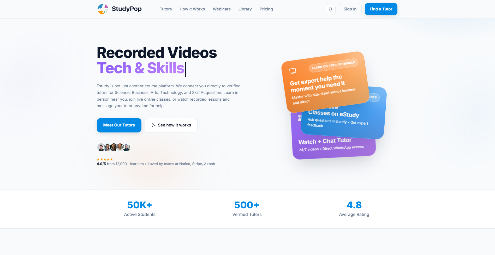

# ICAN UK & District Society Website

A premium, responsive website for the Institute of Chartered Accountants of Nigeria — UK & District Society. The project combines editorial design, CSS 3D effects and a lightweight Three.js particle layer.

[](https://okeyodev.github.io/ican-uk-premium-website/)

**Live site:** [https://okeyodev.github.io/ican-uk-premium-website/](https://okeyodev.github.io/ican-uk-premium-website/)

## Preview



## About the Website

The website presents ICAN UK's heritage, leadership, objectives and member community. It also includes a dedicated conference experience for the 2026 international conference.

### Main homepage

- Cinematic hero with a CSS 3D ICAN core
- Society history and timeline
- Executive committee profiles
- Aims and objectives
- Conference highlights
- Events and countdown
- Member resource hub
- Responsive navigation and footer

### Conference page

- Conference overview and key details
- Conference themes and attendee profiles
- Previous conference gallery
- Agenda filtering and session details
- Speakers and ticket options
- Venue, travel and FAQ sections
- Mobile registration call-to-action

## Technology

- HTML5
- CSS3 with custom properties and CSS 3D
- Vanilla JavaScript and ES modules
- Three.js for an optional ambient particle layer
- Intersection Observer for scroll reveals
- Web Animations and `requestAnimationFrame`
- Google Fonts: Inter and Space Grotesk

There is no framework, package manager or build step required.

## Project Structure

```text
.
├── index.html                 # Main society website
├── conference.html            # ICAN UK Conference 2026 page
├── Screenshot.png             # Repository preview image
├── css/                       # Shared and page-specific styles
├── js/                        # Main and conference JavaScript modules
│   ├── main.js
│   ├── conference/
│   └── three/
└── images/                    # Logos, executive photos and conference assets
```

## Run Locally

Because the project uses JavaScript modules and dynamic imports, serve it through a local HTTP server rather than opening the HTML files directly.

### Using Node.js

```bash
npx serve .
```

Then open the local address printed in the terminal, usually `http://localhost:3000`.

### Using Python

```bash
python -m http.server 8000
```

Visit `http://localhost:8000`.

Direct entry points:

- Homepage: `index.html`
- Conference: `conference.html`

## Conference Content

Conference content and configuration are managed in [js/conference/data.js](./js/conference/data.js). Update that file to change agenda sessions, speakers, ticket prices, themes, FAQs and conference information.

Other conference modules are located in [js/conference/](./js/conference/).

## Customization

- Replace and add media inside [images/](./images/)
- Update shared colours and typography in [css/variables.css](./css/variables.css)
- Update homepage content in [index.html](./index.html)
- Update conference content in [conference.html](./conference.html) and [js/conference/data.js](./js/conference/data.js)
- Shared CSS 3D, layout and animation styles are in [css/](./css/)

## Performance and Accessibility

- Animation is limited primarily to transforms and opacity
- Images use lazy loading where appropriate
- Scroll effects respect `prefers-reduced-motion`
- Low-end devices and devices without WebGL do not run the Three.js particle enhancement
- Navigation, agenda and conference interfaces include accessible labels and keyboard interactions

## Deployment

The live site is hosted with GitHub Pages. Push changes to the repository's `main` branch to update the deployed website, subject to the configured Pages workflow.
